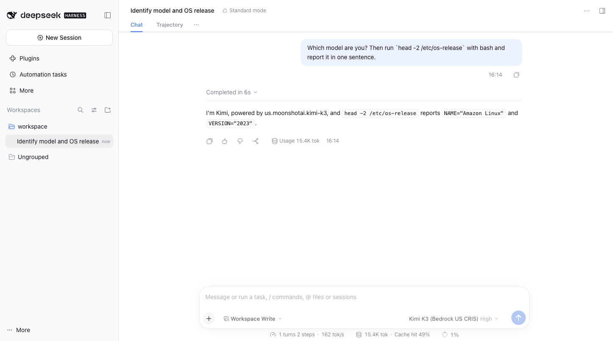

# DeepSeek Harness + Kimi K3 (Amazon Bedrock) on AWS Lambda MicroVMs

把 [DeepSeek Harness (dsh)](https://github.com/deepseek-ai/deepseek-harness) 这个开源 agent harness 部署进 AWS Lambda MicroVM,模型走 Amazon Bedrock 上的 **Kimi K3**。每个用户/会话一台 Firecracker MicroVM:浏览器里用 dsh Web UI 对话,或者用 HTTP API 提交无人值守的 headless 任务。

本目录已在账号 `710299592439` / `us-east-1` 实测跑通(2026-11-04,dsh `0.2.1-rc.5`,image version `1.0`)。用这套架构生成的案例报告见 [report/](report/)。



## 方案选型:为什么不是 kimi-plugin-cc

你给的参考 [linxule/kimi-plugin-cc](https://github.com/linxule/kimi-plugin-cc) 解决的是另一个问题:它让 Claude Code / Codex / DSH 这些**宿主**去调用本地的 **Kimi Code CLI**,拿 Kimi 当"第二意见"(ask/review/rescue/swarm 七个工具)。如果按它的路子走,需要:

- 在 MicroVM 里再装一个 Kimi Code CLI(插件只认证了 2.3.0–2.4.1 这几个固定版本),
- 让 Kimi CLI 的 provider 指向 Bedrock,
- 主 agent 本身仍然要用某个模型(DSH 默认是 DeepSeek 官方 API)。

这就有两个模型、两套凭证、两个 harness,而且 Kimi K3 只是被动的审阅者。我们要的是"**Kimi K3 作为 DSH 的主模型**",更直接的做法是:

| 方案 | 主 agent 模型 | 额外组件 | 结论 |
|------|--------------|----------|------|
| kimi-plugin-cc | DSH 默认模型;Kimi 只是子工具 | Kimi Code CLI + 插件 + hook | 适合"多模型交叉审阅",不适合本需求 |
| DSH 内置 `amazon-bedrock` provider | Kimi K3 | 无 | pi-ai 目录里 Kimi K3 走 **Converse**;模型卡明确说 Converse 在多轮回放 reasoning 时会 `InternalServerException`,agent 循环正好每轮都回放 → 不采用 |
| **DSH 自定义 provider(openai-completions)+ 机内 SigV4 代理** | **Kimi K3,走 Chat Completions** | 一个约 100 行的签名代理 | **采用**:模型卡推荐的 API;实测流式工具调用 + `reasoning_content` 回放 + `reasoning_effort` 都正常;Agent 拿不到任何 AWS 凭证 |

> Bedrock 的 OpenAI 兼容端点 `https://bedrock-runtime.<region>.amazonaws.com/openai/v1/chat/completions` 接受标准 **SigV4(service=`bedrock`)**,所以不需要长期 Bedrock API Key,MicroVM 执行角色就够了。

## 架构

```
 浏览器 ── node scripts/connect.mjs ─┐                 (本机,用你的 AWS CLI 凭证每 55 分钟换一次 auth token)
 task.sh / curl ─────────────────────┤ X-aws-proxy-auth
                                     ▼
          https://<id>.lambda-microvm.us-east-1.on.aws  (MicroVM 专属 HTTPS 端点,默认转到 :8080)
┌──────────────────────── Lambda MicroVM (Firecracker, ARM64, AL2023) ─────────────────────────┐
│  root: sidecar (node /opt/sidecar/server.mjs)                                                  │
│   :9000  lifecycle hooks  ready/validate/run/resume/suspend/terminate                          │
│   :8080  gateway   /__sidecar/{health,launch,tasks,files}   其余 → dsh web 127.0.0.1:3080      │
│   127.0.0.1:8787  Bedrock 代理  模型白名单 + SigV4(执行角色,IMDSv2) ──────────────► Bedrock   │
│                                                                    /openai/v1/chat/completions │
│  uid 1000 "agent" (setpriv: 无 capability, no_new_privs, 无 AWS_* 环境变量, IMDS 被策略路由封禁) │
│   dsh --profile web      (浏览器会话)                                                           │
│   dsh --profile headless (每个 task 一个进程, cwd=/workspace/tasks/<id>)                        │
│     └ provider bedrock-kimi → http://127.0.0.1:8787/openai/v1 → us.moonshotai.kimi-k3           │
└────────────────────────────────────────────────────────────────────────────────────────────────┘
```

### 关键设计点

- **凭证边界**:MicroVM 执行角色的凭证经 IMDSv2 下发(不是环境变量)。sidecar 在 `/run` 时给 uid 1000 加一条 `ip rule uidrange 1000-1000 → table 100`,表里只有到 `169.254.169.254`、`169.254.170.2` 等地址的 `prohibit` 路由。guest 内核没有 `xt_owner`/nft inet,但策略路由可用(思路来自 [sample-multi-tenant-ai-agents-on-lambda-microvm](https://github.com/aws-samples/sample-multi-tenant-ai-agents-on-lambda-microvm) 的 nonroot 文档)。启动时 sidecar 会以 agent 身份 `curl` IMDS,验证确实连不上,结果在 `/__sidecar/health` 的 `imdsFence` 字段。Agent 的 bash 可以随便执行命令,但 AWS 上它唯一能做的事是"经代理调用白名单里的 Kimi K3"。
- **执行角色最小权限**(`infra.yaml`):只有 `us./global.moonshotai.kimi-k3` 推理配置文件 + 对应 foundation model 的 `InvokeModel*`,外加写自己的日志。
- **快照**:`/ready` 在 `dsh web` 完全启动前返回 503,所以快照里是一个热的 harness。`/validate` 也启用,让 Lambda 学习运行时访问哪些页面并预取。
- **每台 VM 独立的 Web 令牌**:快照是所有 VM 共享的内存镜像,`dsh web` 的启动令牌和 cookie 签名密钥也在里面。`/run` hook 会重启 `dsh web`,让每台 VM 生成自己的令牌(`DSH_WEB_ROTATE_ON_RUN=false` 可关闭)。
- **Host/Origin 重写**:dsh 的浏览器信任栅栏只接受 loopback 或 `--trusted-host`,而 MicroVM 端点主机名要到运行时才知道。gateway 把 Host/Origin 改写成 `127.0.0.1:3080`,这样一个镜像能用于所有 VM。认证仍有两层:MicroVM 代理 token,加上 dsh 自己的启动令牌和签名 cookie。
- **挂起/恢复**:`/resume` 重置凭证缓存(恢复后所有出站连接都会被杀掉)。代理遇到 403 "expired token" 会重新取凭证并重试一次。
- **空闲判定只看入站流量**:长 headless 任务没人轮询时,平台会认为 VM 空闲并挂起它。`task.sh` 每 15 秒轮询一次,顺带保活。

## 部署

前置:AWS CLI v2 带 `lambda-microvms` 子命令(`aws lambda-microvms help`)、所在区域已开通 Kimi K3(`aws bedrock get-inference-profile --inference-profile-identifier us.moonshotai.kimi-k3`)、本机 Node ≥ 18、`zip`。

```bash
export AWS_PROFILE=<profile> AWS_REGION=us-east-1

./scripts/deploy.sh        # CFN(桶 + build role + execution role) → 上传 zip → 构建镜像(实测约 4 分钟)
./scripts/run.sh           # run-microvm,等 sidecar 通过端点应答;写 .microvm.env(实测 12.5 秒)

# 方式一:浏览器
node scripts/connect.mjs   # 打开 http://127.0.0.1:3080/__sidecar/launch → 选 workspace /workspace → 聊天

# 方式二:无人值守任务
./scripts/task.sh "用 web_fetch 调研 X,写一份 report.md"
./scripts/task.sh -f report/prompt.md          # 产物下载到 outputs/<task-id>/

./scripts/teardown.sh --yes                    # 删 MicroVM、镜像所有版本、桶内容、CFN 栈
```

本地调试(不进 MicroVM):`docker build -t dsh-kimi-microvm microvm-image/`,然后带上 `--cap-add NET_ADMIN` 和临时 AWS 凭证运行即可。sidecar 的凭证链会从环境变量取凭证。

### Sidecar HTTP API(经 MicroVM 端点,需 `X-aws-proxy-auth`)

| 方法 & 路径 | 说明 |
|------|------|
| `GET /__sidecar/health` | dsh web 状态、Bedrock 调用统计、IMDS 栅栏验证结果 |
| `GET /__sidecar/launch` | 302 到带当前启动令牌的 dsh Web UI |
| `POST /__sidecar/tasks` `{"prompt": "...", "permissionMode": "workspace-write"}` | 启动 `dsh --profile headless --json`,并发上限 `MAX_CONCURRENT_TASKS`(2) |
| `GET /__sidecar/tasks[/<id>]` | 状态、工具调用次数、token 用量、最终回答 |
| `GET /__sidecar/tasks/<id>/events` | 完整 NDJSON 运行事件 |
| `POST /__sidecar/tasks/<id>/cancel` | 终止任务 |
| `GET /__sidecar/files/<path>` | 列目录 / 下载 `/workspace` 下的文件(防路径穿越、防 symlink 逃逸) |

## 测试场景

以下场景都在 2026-11-04 实际跑过,按顺序就是一次完整的验收流程。

| # | 场景 | 怎么测 | 验证点 | 结果 |
|---|------|--------|--------|------|
| 1 | Bedrock Chat Completions 接受 SigV4 | 本机用 botocore `SigV4Auth(service="bedrock")` 签名,POST `/openai/v1/chat/completions`,模型 `us.moonshotai.kimi-k3` | 不用 Bedrock API Key,IAM 凭证即可调用 | ✅ 200,返回 `reasoning_content` |
| 2 | Kimi K3 的 agent 循环兼容性 | 流式请求带 `tools`,拿到 tool call 后,第二轮分别带上/不带上一轮的 `reasoning_content` 回放;再测 `developer` role | 流式工具调用、reasoning 回放(Converse 在这里会报错)、`reasoning_effort` 都可用 | ✅ 全部正常 |
| 3 | 本地 Docker 冒烟 | `docker build microvm-image/`,带 `--cap-add NET_ADMIN` 和临时凭证运行;`POST :9000/.../ready`;`GET /__sidecar/health` | dsh web 能起来,`/ready` 返回 200,IMDS 栅栏生效 | ✅ dsh web 3.4 秒就绪,agent 访问 IMDS 得到 curl exit 7 |
| 4 | 本地 headless 任务 | `POST /__sidecar/tasks`:"写一个 hello.md 俳句然后回复 DONE" | dsh → SigV4 代理 → Kimi K3 → `write` 工具,文件落盘 | ✅ 3 次 Bedrock 调用,文件生成。顺带发现 0.2.1-rc.5 不支持 `--permission-mode`,已改成用环境变量 |
| 5 | 构建 MicroVM 镜像 | `./scripts/deploy.sh` | CFN 栈创建,镜像版本 `IN_PROGRESS → SUCCESSFUL`,build 日志里能看到 `/ready`、`/validate` 两个 hook 被调用 | ✅ 约 4 分钟,version `1.0` |
| 6 | 启动 MicroVM | `./scripts/run.sh` | 用"能否 ingress"判断就绪,而不是 `get-microvm` 的状态;`/run` hook 重新加 IMDS 栅栏并轮换 dsh web 令牌 | ✅ 12.5 秒端点应答,`imdsFence.verified=true` |
| 7 | 自动挂起 / 恢复 | 空闲超过 `maxIdleDurationSeconds`(900 秒)后 `get-microvm` 显示 `SUSPENDED`,再 `curl /__sidecar/health` | 流量自动恢复 VM,内存状态保留(dsh web 没有重启) | ✅ 首个请求 2.5 秒返回,`restarts: 0` |
| 8 | MicroVM 内的隔离探针 | `./scripts/task.sh` 让 agent 在 bash 里执行 `id`、`curl` IMDS、`env \| grep -c ^AWS_`、`uname -r`、`nproc`、`free -m`,再 `web_fetch` 一个 HN 搜索 | agent 是 uid 1000 的非 root 用户、拿不到 IMDS、没有 AWS 环境变量,但能访问公网 | ✅ 39 秒,3 次工具调用,四项都符合预期 |
| 9 | 浏览器交互(Web UI) | `node scripts/connect.mjs`,打开 `/__sidecar/launch`,选 workspace `/workspace`,问"你是什么模型,并用 bash 跑 `head -2 /etc/os-release`" | 本地隧道 + MicroVM 代理 token + dsh 启动令牌/cookie 这条链路,包括 WebSocket 流式输出;模型选择器默认是 Kimi K3 | ✅ 6 秒完成,回答 `us.moonshotai.kimi-k3` / Amazon Linux 2023(见上方截图) |
| 10 | 长任务:生成电商 Agentic 可交互报告 | `./scripts/task.sh -f report/prompt.md`:要求 agent 用 `web_fetch` 实地调研,输出单文件 `report.html` + `data.json` + `sources.md`,并自检 | 长时间多步工具调用;轮询保活使 VM 不被挂起;产物能经 files API 下载 | ✅ 7 分 50 秒、57 次工具调用、15 个案例、28 个来源;人工审核通过(数据一致性、来源覆盖、关键数字抽查、Playwright 交互测试),产物在 [report/](report/) |

## 实测记录(us-east-1)

| 项 | 结果 |
|----|------|
| 镜像构建(create → SUCCESSFUL) | 约 4 分钟;zip 16 KB,dsh 安装后约 850 MB |
| `run-microvm` → 端点首次应答 | 12.5 秒 |
| 挂起状态下的首个请求(自动恢复) | 2.5 秒 |
| `/run` 里重启 dsh web(轮换令牌) | 约 58 秒(本地 Docker 3.4 秒);这段时间 headless 任务不受影响,Web UI 的 `/__sidecar/launch` 会等待 |
| MicroVM 内资源 | 8 vCPU、约 16 GB 内存(`minimumMemoryInMiB=4096` 为基线,平台可纵向扩展),内核 6.1.166 aarch64 |
| 探针任务(bash + web_fetch + 写文件) | 39 秒,3 次工具调用;验证了 `id`=agent、IMDS curl exit 7、`AWS_*` 变量 0 个 |
| Web UI 对话 | 6 秒完成一轮(含一次 bash 调用),缓存命中 49% |

## 已知限制 / 待改进

- dsh 是 developer preview(`0.2.x`),版本间有破坏性变更,镜像里固定了 `DSH_VERSION`。`0.2.1-rc.5` 的 headless 还不支持 `--permission-mode`,sidecar 改用 `DSH_PERMISSION_MODE` 环境变量。
- dsh 默认的 `web_search` provider 需要 DeepSeek API Key,这里没配,所以 agent 只有 `web_fetch`(抓给定 URL)和 bash `curl`。要真正的搜索,可以加一个搜索 MCP 或 [dsh-plugins](https://github.com/genesis-agents/dsh-plugins) 里的 Serper/Tavily/Brave 插件(需要各自的 key,存在 SSM/Secrets Manager,由 sidecar 代理注入)。
- 出站目前是公网全开(默认 egress)。生产环境建议用 VPC egress connector + NAT/代理白名单。
- 状态只在 MicroVM 生命周期内(最长 8 小时,挂起时间也计入)。需要持久会话就要像 multi-tenant 示例那样挂 EFS,或者在 `/terminate` 时把 `/workspace` 和 `~/.dsh/sessions` 同步到 S3。
- 单租户演示:一台 VM 一个用户。多租户需要一个编排层(按用户 `run-microvm`、按需 resume、回收),可直接参考 multi-tenant 示例的 orchestrator。
