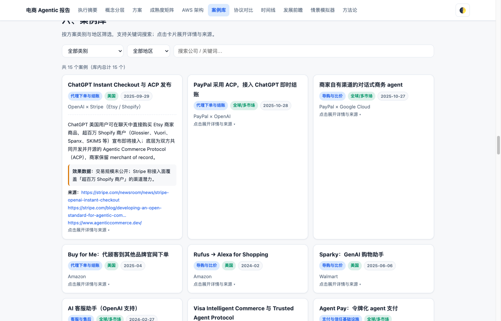
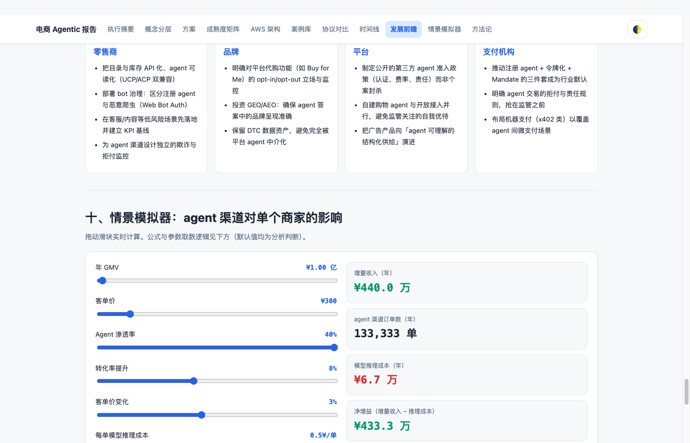

# 电商 Agentic 方案、案例与发展前瞻(可交互报告)

由运行在 Lambda MicroVM 里的 DeepSeek Harness + Kimi K3(Bedrock)一次性生成(测试场景 10)。下载 [report.html](report.html) 后在浏览器打开即可;单文件、无外部依赖,离线可用。

| 文件 | 说明 |
|------|------|
| [prompt.md](prompt.md) | 交给 agent 的完整任务说明(研究约束、结构、交互、自检要求) |
| [report.html](report.html) | 报告本体:导航滚动高亮、案例库筛选/搜索/展开、成熟度矩阵(悬停)、时间线(事实/预测分样式)、情景模拟器、协议表排序、深浅色切换 |
| [data.json](data.json) | 报告全部结构化数据,与 HTML 内的 `const DATA` 完全一致 |
| [sources.md](sources.md) | 28 个来源:URL、标题、抓取日期、要点 |

## 生成过程

- 任务:`./scripts/task.sh -f report/prompt.md`,在 `microvm-730b5128-…` 中运行
- 耗时 7 分 50 秒,57 次工具调用(`web_fetch`、`bash`、`write` 等)
- Token:输入 78,433、输出 48,940、缓存读 1,658,779。缓存读占输入侧的 95%,按 `us.moonshotai.kimi-k3`(US CRIS)标准价估算约 $1.61(输入 $0.26 + 输出 $0.81 + 缓存读 $0.55)。如果完全没有缓存命中,同样的 token 量约 $6.5

## 人工审核(提交前做过的检查)

| 检查项 | 结果 |
|--------|------|
| `data.json` 与 HTML 中 `const DATA` 是否一致 | 一致 |
| 是否有外部 `<script src>` / `<link href>` / `` | 无 |
| HTML 中的 URL 是否都在 `sources.md` 中 | 28/28 |
| 内容规模 | 案例 15、方案 7、协议 8、时间线 23 项(其中 5 项为预测)、来源 28 |
| 抽查关键数字是否出现在 agent 实际抓取的原文中 | 阿里广告 ROAS +12%(CNBC)、Walmart Sparky 购物篮 +38%(CNBC-TV18)、Klarna 4000 万美元利润 / 重复咨询 -25%(Klarna 新闻稿):均能在原文中找到 |
| 浏览器交互(Playwright) | 类别筛选(payment → 2 张卡片)、地区筛选、搜索(Walmart → 1)、卡片展开带来源链接、模拟器滑块实时重算、协议表排序、主题切换、时间线展开、矩阵悬停提示、导航高亮、390px 移动端无横向溢出:全部通过,无 JS 报错 |

## 阅读时请注意(agent 自己指出的薄弱处)

1. Walmart +38%、阿里 +12%、Klarna 4000 万美元都是**企业自述**,没有第三方审计。
2. UCP(Universal Commerce Protocol)的细节主要来自单一二手来源。agent 没抓到 ucp.dev 的一手规范页。
3. Mastercard、AP News、OpenAI 官网有反爬,相关事实改由 Cloudflare、PYMNTS 等二手来源支撑。前瞻章节的份额、情景和成熟度评分都标注为「分析判断」。

agent 抓取的原始网页(`outputs/<task-id>/fetched/`)是第三方内容,没有提交到仓库。
